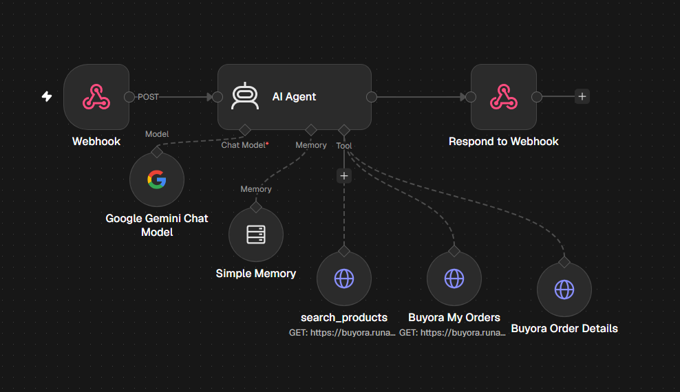
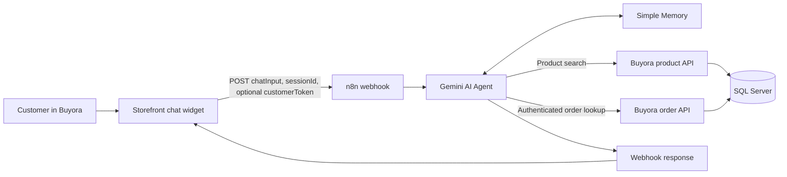

<div align="center">
  
  <h1>Buyora — Bilingual E-Commerce Platform</h1>
  <p><strong>A modern, production-ready e-commerce platform built with ASP.NET Core MVC on .NET 10, featuring an autonomous AI customer-support assistant.</strong></p>

  <p>
    <a href="https://buyora.runasp.net" target="_blank"></a>
    
    
    
    
  </p>
</div>

---


# Buyora

Buyora is a bilingual e-commerce platform built with ASP.NET Core MVC. Customers can browse products, search by category, manage a shopping cart, place cash-on-delivery orders, and review their order history. Store staff manage the catalog, categories, orders, and users through a separate admin area. A customer-support assistant connects the storefront to an n8n workflow and the Buyora chat API.

**Production site:** [https://buyora.runasp.net](https://buyora.runasp.net)  
**Languages:** Arabic (Egypt) and English  
**Runtime:** .NET 10 / ASP.NET Core MVC

---

## Features Overview

### Storefront

- Responsive storefront with Arabic RTL and English LTR layouts.
- Product catalog with categories, live search, product details, images, prices, and discounts.
- Shopping cart with quantity updates and item removal.
- Checkout and order confirmation for cash-on-delivery orders.
- Customer order history, order details, shipping status, and tracking information.
- Identity accounts, registration, email confirmation, password reset, and Google sign-in.
- Customer-support chat widget with a 24-hour browser conversation history.

### Administration

- Dashboard with revenue, order, product, category, and inventory summaries.
- Product and category creation, editing, visibility controls, and image uploads.
- Order management and customer status notifications by email.
- User and role management for administrators and employees.

### Customer-support automation

- n8n receives messages from the storefront webhook and uses a Gemini chat model.
- Product search supports category, text, price range, discount, and price-order filters.
- Order tools return only the authenticated customer's orders through a short-lived protected token.
- The n8n Simple Memory node uses the browser session ID and is configured with a context-window length of 10.

---

## Technology Stack

- ASP.NET Core MVC and .NET 10
- Entity Framework Core 10 and Microsoft SQL Server
- ASP.NET Core Identity
- AutoMapper
- Bootstrap 5, Bootstrap Icons, jQuery, and Chart.js
- ASP.NET Core localization and resource files
- n8n Cloud, Google Gemini, and HTTP Request tools for the assistant

---

## Project Structure

```text
Buyora/
├── Buyora/                         # ASP.NET Core web application
│   ├── Areas/
│   │   ├── Admin/                  # Admin controllers, view models, and views
│   │   ├── Customer/               # Storefront, cart, and customer orders
│   │   └── Identity/               # Login, registration, and account flows
│   ├── Controllers/                # Chat API endpoints
│   ├── DependencyInjection/        # Service, Identity, and database setup
│   ├── Resources/                  # Arabic and English localization resources
│   ├── Views/Shared/               # Store/admin layouts and shared components
│   └── wwwroot/                    # CSS, JavaScript, logos, and uploaded images
├── BuyoraBusiness/                 # Business services and interfaces
├── BuyoraDataAccess/               # EF Core context, repositories, migrations,
│                                   # and database initialization
├── BuyoraModels/                   # Domain entities and DTOs
├── BuyoraUtility/                  # Shared constants and utility code
├── n8n/
│   ├── Buyora workflow.json        # Importable n8n workflow export
│   └── Workflow.png                # Workflow overview image
├── Buyora.slnx                     # Solution file
└── README.md
```

> Product images uploaded at runtime are stored under `Buyora/wwwroot/Images/Products`. Keep this directory persistent and include it in backups when deploying or moving the application.

---

## Requirements

- .NET 10 SDK
- SQL Server: LocalDB, SQL Server Express, or a hosted SQL Server database
- Google OAuth 2.0 web client credentials (required by the current startup configuration)
- SMTP account settings for email confirmation, password reset, and order notifications
- n8n instance and Google Gemini credentials to run the assistant workflow
- Git (optional, for cloning the repository)

---

## Setup Instructions

### 1. Get the source and restore packages

```bash
git clone <repository-url>
cd Buyora
dotnet restore Buyora.slnx
```

Open `Buyora.slnx` in Visual Studio 2022 or later, or continue with the .NET CLI.

### 2. Configure local secrets

The web project already has a User Secrets ID. User Secrets are stored outside the repository and are suitable for local development only. Run these commands from the repository root, replacing each placeholder with your own value:

```bash
dotnet user-secrets set "ConnectionStrings:DefaultConnection" "<LOCAL_SQL_SERVER_CONNECTION_STRING>" --project Buyora/Buyora.csproj
dotnet user-secrets set "Authentication:Google:ClientId" "<GOOGLE_OAUTH_CLIENT_ID>" --project Buyora/Buyora.csproj
dotnet user-secrets set "Authentication:Google:ClientSecret" "<GOOGLE_OAUTH_CLIENT_SECRET>" --project Buyora/Buyora.csproj
dotnet user-secrets set "App:BaseUrl" "https://localhost:7298" --project Buyora/Buyora.csproj
```

The connection string must point to a SQL Server database. A local SQL Server Express example is:

```text
Server=localhost;Database=Buyora;Trusted_Connection=True;Encrypt=True;TrustServerCertificate=True
```

For Google sign-in, add the matching local callback URI to the OAuth web client:

```text
https://localhost:7298/signin-google
```

Use the HTTPS URL and port printed by your local launch profile if they differ.

### 3. Configure email (SMTP)

Email settings are read when the application sends an email. Configure them if you use email confirmation, password reset, or order status notifications:

```bash
dotnet user-secrets set "Smtp:Host" "<SMTP_HOST>" --project Buyora/Buyora.csproj
dotnet user-secrets set "Smtp:Port" "587" --project Buyora/Buyora.csproj
dotnet user-secrets set "Smtp:Username" "<SMTP_USERNAME>" --project Buyora/Buyora.csproj
dotnet user-secrets set "Smtp:Password" "<SMTP_PASSWORD_OR_APP_PASSWORD>" --project Buyora/Buyora.csproj
dotnet user-secrets set "Smtp:From" "<SENDER_EMAIL>" --project Buyora/Buyora.csproj
```

The application uses TLS for SMTP. Port `587` is the default if `Smtp:Port` is omitted. For Gmail, use an app password where Google requires one; do not use your normal account password.

### 4. Configure the first administrator (optional)

The startup initializer creates the `Admin`, `Employee`, and `Customer` roles. To create the initial administrator, configure **both** values before the first startup:

```bash
dotnet user-secrets set "Admin:Email" "<ADMIN_EMAIL>" --project Buyora/Buyora.csproj
dotnet user-secrets set "Admin:Password" "<STRONG_ADMIN_PASSWORD>" --project Buyora/Buyora.csproj
```

The initializer creates the administrator only if that email does not already exist, then ensures the account has the `Admin` role. It does not reset the password of an existing account. If both settings are omitted, roles are still created but no administrator account is seeded. Do not configure only one of the two values.

### 5. Create/update the database and run the application

The application applies pending EF Core migrations during startup. The database must be reachable, and the configured SQL user must be allowed to create or update the schema.

```bash
dotnet run --project Buyora/Buyora.csproj
```

Open the HTTPS address printed in the console. The default culture is Arabic (Egypt); use the language selector to switch to English.

To apply migrations explicitly during development, install `dotnet-ef` if needed and run:

```bash
dotnet tool install --global dotnet-ef
dotnet ef database update --project BuyoraDataAccess/BuyoraDataAccess.csproj --startup-project Buyora/Buyora.csproj
```

---

## Configuration and Secrets

The application reads configuration from `appsettings.json`, the environment-specific `appsettings.{Environment}.json`, User Secrets in development, and environment variables. Nested environment variable names use double underscores (`__`) in place of colons.

| Configuration key | Environment variable | Required | Purpose |
| --- | --- | --- | --- |
| `ConnectionStrings:DefaultConnection` | `ConnectionStrings__DefaultConnection` | Yes | SQL Server connection |
| `Authentication:Google:ClientId` | `Authentication__Google__ClientId` | Yes at startup | Google sign-in client ID |
| `Authentication:Google:ClientSecret` | `Authentication__Google__ClientSecret` | Yes at startup | Google sign-in client secret |
| `App:BaseUrl` | `App__BaseUrl` | Yes for production links | Public site origin used in email and product links |
| `Smtp:Host` | `Smtp__Host` | When sending email | SMTP server host |
| `Smtp:Port` | `Smtp__Port` | Optional | SMTP port; defaults to `587` |
| `Smtp:Username` | `Smtp__Username` | When sending email | SMTP account username |
| `Smtp:Password` | `Smtp__Password` | When sending email | SMTP password or app password |
| `Smtp:From` | `Smtp__From` | When sending email | Sender address; defaults to the SMTP username |
| `Admin:Email` | `Admin__Email` | Optional pair | Email for first administrator seeding |
| `Admin:Password` | `Admin__Password` | Optional pair | Password for first administrator seeding |
| ASP.NET Core environment | `ASPNETCORE_ENVIRONMENT` | Production hosting | Set to `Production` on the hosting provider |

Never commit real connection strings, passwords, OAuth secrets, SMTP credentials, Web Deploy profiles, or API keys. Keep `appsettings*.json` free of credentials. Configure production values through the hosting provider's environment-variable or secret settings. `App:BaseUrl` is not a secret; set it to the canonical HTTPS origin, currently `https://buyora.runasp.net`.

Google OAuth must include this production redirect URI:

```text
https://buyora.runasp.net/signin-google
```

If you use a custom domain, update `App:BaseUrl`, the Google authorized origin and redirect URI, and the n8n allowed origin to that same domain.

### MonsterASP.NET deployment notes

1. Confirm the hosting plan supports ASP.NET Core on .NET 10 and create the SQL Server database/user in the hosting control panel.
2. Copy the host-provided **local connection string** into `ConnectionStrings__DefaultConnection` in the site's environment-variable settings. Do not commit it in the repository.
3. Set `ASPNETCORE_ENVIRONMENT=Production`, `App__BaseUrl=https://buyora.runasp.net`, both Google OAuth variables, SMTP variables, and the optional administrator pair in the hosting settings. Restart the application after changing them.
4. In Visual Studio, import the host's Web Deploy publish profile, choose `Release`, and publish the `Buyora` web project. Keep the publish profile private; it contains deployment credentials.
5. Configure the Google OAuth production callback shown above and verify SMTP from the deployed environment.
6. Ensure the runtime-uploaded `wwwroot/Images/Products` files and the Data Protection key directory remain on persistent writable storage across publishes and app-pool restarts.
7. Back up both the SQL database and product image files before production updates.

The application stores non-development Data Protection keys in `../private/keys` relative to the web content root. The host must allow this directory to be created and written to; persistent keys preserve Identity cookies and protected chat tokens across restarts.

---

## n8n Customer-support Automation

The n8n workflow is stored in this repository:

- [Importable workflow JSON](n8n/Buyora%20workflow.json)
- [Workflow image](n8n/Workflow.png)

The current production webhook is `https://gomaa1212.app.n8n.cloud/webhook/buyora-chat`.



### Workflow behavior

1. The storefront sends `chatInput` and a per-conversation `sessionId` to the n8n production webhook.
2. The AI Agent uses the Google Gemini Chat Model (`models/gemini-3.5-flash`) and Simple Memory node (context-window length 10).
3. `search_products` calls the public product-search API and can filter by text, category, price range, price order, or discount.
4. `Buyora My Orders` and `Buyora Order Details` call the protected order API using the short-lived customer token supplied by the storefront.
5. `Respond to Webhook` returns the assistant response to the chat widget.



### API routes used by the workflow

| Method | Route | Access |
| --- | --- | --- |
| `GET` | `/api/chat/products` | Public; supports `search`, `category`, `sort`, `discountsOnly`, `minPrice`, `maxPrice`, `page`, and `pageSize` |
| `POST` | `/api/chat/session-token` | Requires a signed-in customer; issues a protected token valid for 10 minutes |
| `GET` | `/api/chat/me/orders` | Requires `Authorization: Bearer <customer-token>` |
| `GET` | `/api/chat/me/orders/{id}` | Requires `Authorization: Bearer <customer-token>` and only returns an order owned by that customer |

### Import and configure the workflow

1. In n8n, import `n8n/Buyora workflow.json`.
2. Select or create the Google Gemini credential for the **Google Gemini Chat Model** node. Credentials are managed inside n8n and should not be stored in the exported workflow file.
3. Confirm the webhook is `POST` at path `buyora-chat` and the allowed origin is `https://buyora.runasp.net`.
4. Confirm the HTTP tools use the production API routes in the table above. The order-details tool must call `/api/chat/me/orders/{id}`.
5. Save and activate the workflow. Use the **Production URL** after activation.
6. The current storefront webhook URL is set in `Buyora/Views/Shared/_CustomerChatWidget.cshtml` as `data-webhook-url`. Update that value if the n8n production URL changes.

For local chat testing, use a webhook that allows the local site origin and configure the HTTP tools to reach the intended local or public API. The committed workflow is configured for the production site. The widget stores its conversation in browser local storage for 24 hours; order tokens are short-lived and are not persisted with the chat history.

---

## Localization

Localization strings live in:

- `Buyora/Resources/SharedResource.ar-EG.resx`
- `Buyora/Resources/SharedResource.en-US.resx`

When adding a UI string, add the same resource key to both files. The application defaults to `ar-EG` and sets the document direction to RTL or LTR based on the selected culture.

---

## Operational Notes

- The startup initializer applies EF Core migrations and creates the standard Identity roles. Startup fails if the database is unreachable or the migrations cannot be applied; inspect the hosting logs for these failures.
- Production exceptions are logged server-side and routed to the customer-friendly Home/Error page. Detailed exception information is not shown to visitors.
- Product image files live on the web server and are not stored in SQL Server. Include them in backups and preserve them during deployment.
- The n8n workflow export contains workflow configuration, not a substitute for creating the Gemini credential in n8n.
- Keep production logs and backups private, and rotate any credential that was accidentally committed or shared.

---

## Contact & Feedback

Have questions, suggestions, or feedback about Buyora? Feel free to reach out!

- **LinkedIn:** [Abdelrahman Mohammed](https://www.linkedin.com/in/abdelrahman-mohammed-87445a284/)
- **WhatsApp:** [+20 111 097 4940](https://wa.me/201110974940)

If you find this project useful or interesting, consider giving it a ⭐ **Star** on GitHub. Your support is greatly appreciated!
